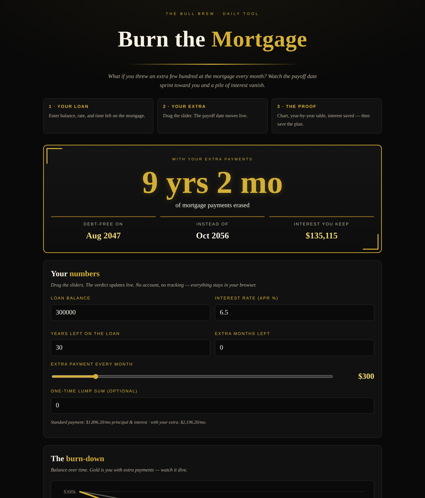

# Burn the Mortgage — Payoff Visualizer

**Live:** https://thebullbrew.github.io/mortgage-payoff-visualizer/

"What if I threw an extra $300 at the mortgage every month?" This visualizer shows the payoff date sprinting toward you and a pile of interest vanishing. Drag the extra-payment slider and watch years of payments get erased live.

## What it does

- **Months/years erased, huge** — the headline number: how much of your mortgage disappears with extra payments.
- **Payoff dates side by side** — debt-free date with extra payments vs. minimum payments.
- **Interest you keep** — total interest saved, in dollars.
- **Burn-down chart** — balance over time, both scenarios overlaid in gold (pure SVG, no libraries).
- **Year-by-year table** — end-of-year balance and cumulative interest, both paths.
- **The front-loaded interest explainer** — why extra principal early kills decades of interest.
- **Saveable scenarios** — keep the plans worth comparing, stored only in your browser.

## The method

Every month, your interest charge is the rate times your *current balance* — so early on, most of your payment is interest. An extra dollar of principal today kills every future interest charge that dollar would have generated. Small extra payments, started early, erase years.

## Run it

No backend, no build step. Open `docs/index.html` in any browser, or visit the live link above. Installable as a PWA (offline-capable).

Built with JavaScript. Part of [The Bull Brew](https://github.com/thebullbrew) daily tool series.
